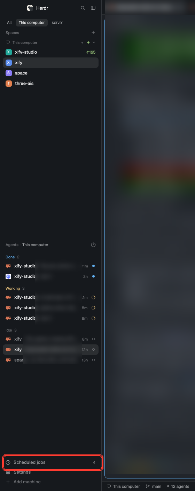

# Scheduled jobs

A "Scheduled jobs" row at the bottom of the sidebar opens a tab where you schedule coding-agent runs. You give a job a time and days (or one date), a folder, an agent command and the first message. At that time the agent starts with that message. In App mode Herdr's own timer opens it as a tab in a "Jobs" space while Herdr is open. In Machine mode the machine's crontab starts it with `hc run --bg`, even when Herdr is closed. Jobs can run on this computer or on another machine Herdr is connected to, and the tab also lists, read-only, the jobs saved in Herdr on your other machines.

## What you see

**Sidebar footer** (the mod with props `{ "view": "sidebar" }`, in a 101px block where Herdr's footer was): `chrome` background, a 1px `border` line on top, padding 8px at the sides, 4px on top and 8px below, 13px text. It has three 28px rows (radius 8, a 14px icon, a 9px gap, `muted` text; on hover `hover` background and `foreground` text):

1. A clock and "Scheduled jobs". On the right are a red badge (`blocked` background, `background` text, 10.5px, radius 4) counting the jobs that need attention, and the total number of jobs in 11.5px `dim`.
2. A gear and "Settings", with a 6px `accent` dot when an app update is ready.
3. A plus and "Add machine", in `dim`.

When the sidebar is narrower than 160px, each row is a 32px icon cell with a tooltip ("Scheduled jobs · 4 total · needs you: 1"), and the badge and the update mark become 6px dots at the icon's top right.

**The Scheduled jobs tab** (the mod without props, as a pane named "Scheduled jobs"): `background`, padding 16, 12px gaps, scrolls.

- **Header:** "Scheduled jobs" (16px semibold) and a line in 11.5px `dim`: "Jobs listed by the app they are saved in. Each job shows the machine it runs on; reading a remote list never runs or copies its jobs." On the right are the buttons "Refresh lists" and "+ Add job" (filled; "Close" while the form is open).
- **Machine chips:** "All", then one chip per Herdr machine, this computer first. Each chip is 30px high with radius 8 and shows a 7px dot (`done` when ready, `working` while loading, `blocked` when unavailable), the name (12.5px; "This computer" for this one), and a count in 11px `dim`. The count is the number of jobs; for another machine it is "…" while loading or "read failed". The selected chip has an `accent` border and a `selected` background.
- **Add form** (a `surface` card, radius 10, padding 14), titled "Saved in: This computer · Runs on: <machine>" (the selected machine, or this computer under All). The fields, top to bottom:
  - Name (placeholder "e.g. Morning PR review");
  - Type: chips Repeat / Once;
  - Date (Once only; YYYY-MM-DD, default tomorrow), Time (HH:MM, default 09:00), and Days (Repeat only): seven 30px chips Su Mo Tu We Th Fr Sa, all on at first;
  - Run mode: chips App / Machine, with a one-line hint for each;
  - Folder (required), with a hint about agents' folder-trust prompts;
  - Agent command (default `claude`);
  - Task (first message), a 3-row text area;
  - an error line in `blocked`, then Cancel and Save (filled).

  Inputs are 32px high with radius 8, an `input` border, a `background` fill and 12.5px text. Buttons are 28px high with radius 7 and 12px text: filled ones use `solid` / `solid_foreground`, the others `raised` with an `input` border.
- **Job cards** for jobs saved here, under "Saved in: This computer" (a `surface` card with a `border` line, radius 10, padding 12). A card shows:
  - the name (13.5px semibold, `muted` when off), with badges App or Machine, and Done, On or Off;
  - "Daily 09:00 · next 11.19(Th) 09:00 · last run …". Dates read `MM.DD(Dd) HH:MM`; days are written like `MoWeFr`; a one-time job reads `Once 2026-11-20 09:00`;
  - for Machine jobs, with the "This computer" chip selected, "In crontab" or "Not in this machine's crontab (Turn off → Turn on adds it again)" in `blocked`;
  - "Missed: <time> (the app was closed)" in `blocked`;
  - "Last run: <status>" with a 7px status dot and an "Open tab" button;
  - "Saved in: This computer · Runs on: <machine>", then "<agent> · <folder>", then the task on one line;
  - the buttons Run now (filled), Turn off / Turn on, Skip missed run (only when one was missed) and Delete.
- **Other machines' lists** (under All, or that machine's chip): "Saved in: <machine> · <its hostname>", then read-only cards with On/Off and "Remote" badges, where each job runs, its mode, days, time and next run (worked out on that machine), agent, folder and task. A footer reads "Remote list saved <time> · read-only, refreshed every minute". While loading it says "Reading the remote app's saved list…". On failure it says "Read failed: <error>", and the last list stays below with "· showing the list from the last read".
- **Crontab box** (when one machine's chip is selected): "<machine>'s crontab (read-only)" with a Refresh button and that machine's non-comment `crontab -l` lines in monospace.
- **Recent runs (app mode):** the last 8 runs, "MM.DD(Dd) HH:MM · <machine> · <name>", with " (manual)" for Run now.

## How it behaves

- **Statuses.** A card's "Last run" follows the agent the job last started:
  - working: "Working", in `working`;
  - blocked: "Needs you", in `blocked`;
  - done: "Done", in `done`;
  - idle: "Idle", in `idle`;
  - no status yet: "Started", in `dim`.

  App jobs track the last tab with the job's name in that machine's "Jobs" space. Machine jobs track the newest terminal named `j<last 6 digits of the job id>-<MMDDhhmm>`. "Open tab" selects that tab, or gives the terminal a tab (`terminal.keep`). A job needs attention when a run was missed or its last agent is blocked.
- **App mode.** Every 30 seconds each live copy (the footer and the tab) checks the enabled App jobs. At a scheduled time it opens a tab named after the job in the run machine's space named "Jobs" (`tab.new`, or `space.new` when there is no such space), without taking focus. The agent command is split on spaces into `argv`, it starts in the job's folder, and the task is its first message. The copy then records the run and adds it to recent runs (30 kept). A notification reads "Job started: <name>" with "<machine> · <command>"; clicking it selects the Jobs space. A Once job turns Done and off. The shared `lastSlot` keeps two copies from starting the same run twice. If Herdr opens up to 10 minutes late, the job still runs. Later than that, the card shows "Missed", and "Skip missed run" marks the time as handled.
- **Machine mode.** Saving writes `~/.herdr-jobs/<id>.sh` (mode 700) on the run machine and adds one crontab line there: `M H * * <days> /bin/sh "$HOME/.herdr-jobs/<id>.sh" # herdr-job:<id>`. Days are 0 = Sunday and the field is `*` for every day; a Once job's line is `M H D Mo *`. The script runs `"$HOME/.local/bin/hc" run --bg --no-parent --name j<6 digits>-<MMDDhhmm> --cwd <folder> <agent argv> <task>` and appends its output to `~/.herdr-jobs/<id>.log`. A Once script first checks the date, then deletes its own crontab line and itself. macOS cron cannot change crontab, so 90 seconds after a Once time the app also removes the line and marks the job Done. Turn off and Delete remove the line and the script. Turn on checks the job again and reinstalls it.
- **Run now** always opens the job as a tab in the Jobs space at once, App or Machine.
- **Saving checks:**
  - the form: a name, HH:MM, a future date for Once, at least one day, a folder and a task;
  - the folder must exist on the run machine, where it is turned into an absolute path (`~` expanded, `pwd -P`);
  - a name already used on the same run machine is refused;
  - agent commands with approval-bypass flags (`--dangerously-bypass…`, `--permission-mode bypassPermissions`) are refused, and `codex` needs `--no-daemon`.
- **Chips.** Selecting a machine reads its crontab (`crontab -l`). The lists of other machines refresh every 60 seconds while the tab is open, and on "Refresh lists".
- **Sidebar row.** "Scheduled jobs" goes to the open Scheduled jobs tab, or opens one (`tab.new {mod: "job-scheduler", name: "Scheduled jobs"}`).
- **Agent API (protocol 1).**
  - Request: a caller creates `<appHome>/job-scheduler-api/<id>.request.json`, where `<id>` is 32 lowercase hex characters. It holds `{ "protocol": 1, "request_id": "<id>", "action": …, "id"?, "job"?, "expectedVersion"? }`. The caller then runs `herdr-app do job-scheduler.api:<id>`. A shown copy answers in `<id>.response.json`: `{ "ok": true, "request_id", … }` or `{ "ok": false, "error" }`. An existing response is never rewritten, so a repeated id gets the same answer. A second request while one is running is refused.
  - Actions:
    - `list`: `version`, jobs without the task text but with `taskLength` and `nextRunAt`, and `machineOffsetMinutes`;
    - `catalog`: `list` plus `remoteApps`;
    - `get`: one full job;
    - `add`, `update`, `enable`, `disable`, `remove`: these need `expectedVersion` from a recent `list`.
  - Job fields: `name` (≤120), `machine` (`null` or a machine name), `type` (`repeat` or `once`), `time` (HH:MM), `days` (0–6) or `date` (YYYY-MM-DD), `mode` (`app` or `machine`), `folder`, `agent`, `task` (≤100,000), `enabled`, and an optional `timezone`. The timezone is only checked against the run machine's offset; it never converts times. `update` cannot move a job to another machine or mode. The tab's own saves go through the same code.

## Built from

- **Files:**
  - `main.js`: the `View`; `props().view === "sidebar"` draws the footer, anything else the tab;
  - `sidebar.js`: the footer;
  - `core.js`: storage, schedule times, App runs, crontab install and removal, opening the tab;
  - `api.js`: one `mutate()` for the screen and the API, plus `handleRequest()`;
  - `catalog.js`: the reader for other machines;
  - `clock.svg`, `settings.svg`, `plus.svg`: Lucide icons, the same files as in Herdr's `workspace-chrome`;
  - `mod.json`: `{ "place": "none" }`.
- **Placement:** in a layout, put `{ "mod": "job-scheduler", "props": { "view": "sidebar" } }` in a 101px block where the sidebar footer `{ "mod": "workspace-chrome", "props": { "footer": true } }` (69px) was. The footer also draws Settings (`app.settings`) and Add machine (`mod.open {name: "machine-add"}`), so you lose nothing.
- **Shared state:** `job-scheduler/jobs` (the list), `job-scheduler/runs` (30 kept), `job-scheduler/focus` (the sidebar asking the tab to show something), `job-scheduler/version` (a counter, raised on every save), `job-scheduler/api-lock` and `job-scheduler/api-claim`.
- **A job:** `{ id: "job-<ms>", name, machine, type, time, days | date, mode, folder, agent, task, enabled, createdAt, lastSlot, lastRunAt, done?, updatedAt?, timezone? }`.
- **`herdr` functions:**
  - data: `spaces`, `panes`, `terminals`, `machines`, `updates`, `layout`, `theme`, `props`, `checking`;
  - `run`: `tab.new`, `space.new`, `space.select`, `tab.select`, `terminal.keep`, `app.settings`, `mod.open`;
  - programs and notices: `exec`, `notify`;
  - state and commands: `shared`, `setShared`, `nextCommand` (`tick`, `api:<id>`);
  - files: `appHome`, `readTextFile`, `writeTextFile`;
  - from gpui-base: `InputState`, `Input`, `TextareaState`, `Textarea`.
- **Programs:** `sh` and `crontab` (this machine and the run machine), `python3` (on other machines), `date` and `env` (only with `timezone`), and cron's `hc` at `$HOME/.local/bin/hc`.
- **Reader for other machines:** `python3 -c` through `exec(…, { on: machine })` with a 15-second timeout. It reads `shared.json` in that machine's Herdr home (`$HERDR_APP_HOME`, else `~/.config/herdr-app`), takes the key `job-scheduler/jobs`, and prints `{ host, savedAt, jobs }`, with each task cut to 240 characters and the next run worked out in that machine's local time.

## Watch out

- **It runs programs.** It calls `exec` on `sh -c` (to check folders, write scripts and edit crontab), `crontab -l`, `python3 -c` on your other machines, and `date` / `env`. In Machine mode, cron later runs `hc run --bg`, which starts an agent with your task while nobody watches.
- **It changes crontab and writes files.** Machine mode adds and removes crontab lines tagged `# herdr-job:<id>`. Other lines are kept: it filters with `grep -v` on the tag and pipes back into `crontab -`. It writes `~/.herdr-jobs/<id>.sh` on the run machine and appends to `~/.herdr-jobs/<id>.log`, which is never deleted.
- **It reads other machines' lists.** On every other machine Herdr knows, it runs a `python3` reader that opens Herdr's `shared.json` there. It returns each job's name, folder, agent, the first 240 characters of the task, and the machine's hostname. It never runs or copies those jobs.
- **Its agent API uses files.** The API is a request/response folder on disk, `<appHome>/job-scheduler-api/`. The caller creates the folder, and responses are left there.
- **App mode needs Herdr open** with a live copy: the footer block in the shown layout, or the tab. Machine mode needs `hc` at `$HOME/.local/bin/hc` on the run machine, and cron runs the script with its own minimal environment.
- **Folder trust.** Agents stop at a folder-trust prompt the first time they open a folder. In the home folder, Claude asks every time. Use a folder you have opened and trusted yourself.
- **Times and copies.** Times are the run machine's local time. Jobs live in each Herdr's shared state and do not sync between machines. The agent command is split on spaces, so it cannot hold quoted arguments.
- **Narrow labels.** Day chips are 30px, so the day names are two letters (Su … Sa) and are joined without spaces on cards.
- **Renaming.** The folder name appears in `DETAIL_MOD = "job-scheduler"` and in the icon paths `mods/job-scheduler/*.svg`. If you rename it, change both.
- **What the check misses.** `herdr-app check` renders only the tab (no props), so it does not exercise the footer view. Try the footer in the app.
- Used on macOS with Herdr 0.1.16.

## Done when

- `herdr-app check` on `mods/job-scheduler` passes.
- In a layout with the footer block, the sidebar ends with "Scheduled jobs", "Settings" and "Add machine". Clicking "Scheduled jobs" opens a tab named "Scheduled jobs".
- An App job saved two minutes ahead opens, at that time, a tab with the job's name in a "Jobs" space, with the agent running the task. A notification "Job started: <name>" appears, and the card shows "Last run: Working".
- A Machine job adds a line ending in `# herdr-job:<id>` to `crontab -l` on its run machine and creates `~/.herdr-jobs/<id>.sh` there. Turn off removes both.
- Writing a `list` request and running `herdr-app do job-scheduler.api:<id>` produces `<id>.response.json` with `"ok": true` and a `version`.
