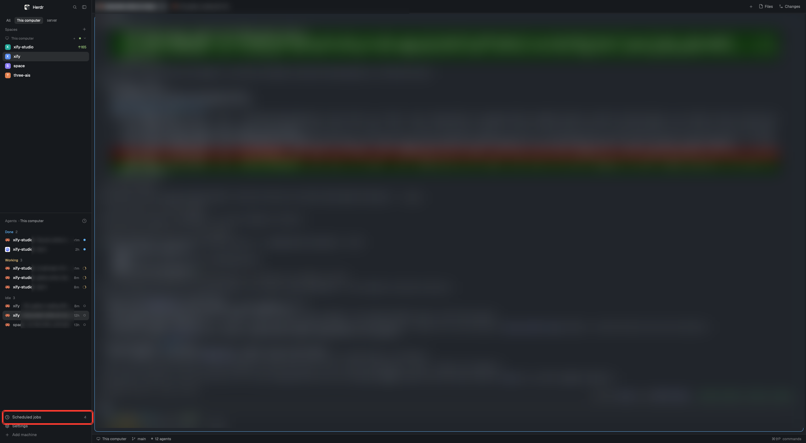

# Main with machine filter

Herdr's main window with one addition at the top of the sidebar and one at the bottom. When Herdr is connected to other machines, a row of chips (All, This computer, then each machine) narrows the Spaces list and the Agents list to one machine at once, so you see only that machine's spaces and agents. The sidebar footer gets a Scheduled jobs row above Settings and Add machine. It opens a tab where you schedule coding-agent runs. The rest is Herdr's `main` layout as shipped.

## What you see

Left to right, then top to bottom:

- **Sidebar**, a column 268px wide (min 44, max 480) on `chrome`:
  - **Brand**, 46px: Herdr's `workspace-chrome` (logo, search, sidebar toggle). Dragging it moves the window.
  - **Spaces** (`spaces-filter`, weight 1, min 90). When Herdr knows at least one other machine and the sidebar is wide, a wrapping row of chips sits above the "Spaces" header: `All`, `This computer`, then the other machines by name. Chips are 22px high with 8px side padding, radius 6 and 11.5px text, 4px apart, in a row padded 12px at the sides, 8px on top and 2px below. The selected chip has a `selected` background and `foreground` text. The others have `muted` text and a `hover` background on hover. Below the chips is Herdr's Spaces list unchanged: groups per machine, colored letter avatars, git branch and ahead/behind. With a filter set, only that machine's group is shown and it cannot be folded.
  - **Agents** (`agents-filter`, weight 1, min 90): Herdr's agents list. With a filter set, the header reads `Agents · This computer` or `Agents · <machine>` (the suffix in `muted`, truncated), and only that machine's agents are listed. If none match, it says `No agents on this computer.` or `No agents on <machine>.`
  - **Footer**, 101px (`job-scheduler` with props `{ "view": "sidebar" }`): a 1px `border` line on top, then three 28px rows with 14px icons and 13px `muted` labels: clock "Scheduled jobs", settings "Settings", plus "Add machine" (in `dim`). "Scheduled jobs" shows a red badge (`blocked` background, 10.5px) with the number of jobs that need attention, then the total job count in 11.5px `dim`. "Settings" shows a 6px `accent` dot when an app update is ready.
- **Work area**, a column:
  - **Tab bar**, 42px (`tabs`); dragging it moves the window.
  - **Body**, a row with 8px padding and 8px gap: the active tab's panes as cards (`background`, 1px `border`, 1px `accent` when focused, radius 10, 8px gap, a 30px `pane` header always shown on top), and a right panel 368px wide (min 280, max 900), hidden at first, that stacks `files` and `changes`.
  - **Status bar**, 28px (`workspace-status`).
- The window: `canvas` behind, 1px `border` dividers, no system title bar, macOS traffic lights at (12, 16), terminal padding 14 × 12.

With the sidebar narrower than 160px, the chips are hidden, the Spaces rail numbers only the shown spaces, and the footer rows become 32px icon cells with tooltips; the attention count becomes a 6px `blocked` dot on the clock.

## How it behaves

- **Agent statuses** look as in Herdr's agents list: grouped under Needs you (blocked), Done, Working and Idle, with Herdr's own row marks (a blue dot for done, a spinner for working, an empty ring for idle). The filter only removes rows. It never changes how a row looks.
- **Chips:** a click sets the shared key `machine.filter`: `null` for All, `"@local"` for This computer, or the machine's name. Both lists follow at once. The value is kept in Herdr's shared state, so it survives a restart. A value naming a machine Herdr no longer knows counts as All.
- **Agent keys:** `agent.next` / `agent.prev` (Herdr's `cmd-]` / `cmd-[`) step only through the agents shown, because the list sets the agent order from the filtered rows.
- **Filter commands** (`spaces-filter.<command>`, only through keys or `herdr-app do`): `cycle` or `filter-next` (the chip to the right, wrapping), `filter-prev`, `all`, `filter-0` … `filter-9` (the chip at that position: 0 All, 1 This computer, 2 and up the other machines), `only:<machine>` (`only:local` for this computer), `select-1` … `select-9` (the nth space now shown), `next` / `prev` (the next or previous shown space, wrapping).
- **Suggested keys** (not shipped; add them to `keys.json` if you want them): in `"global"`, `"cmd-shift-m": "spaces-filter.cycle"`; in a `"layout:main-filter"` section, `ctrl-1` … `ctrl-9` → `spaces-filter.select-1` … `select-9`, `cmd-ctrl-0` … `cmd-ctrl-9` → `spaces-filter.filter-0` … `filter-9`, `cmd-ctrl-up` / `cmd-ctrl-down` → `spaces-filter.prev` / `next`, `cmd-ctrl-left` / `cmd-ctrl-right` → `spaces-filter.filter-prev` / `filter-next`. Without the layout section, `ctrl-1` … `ctrl-9` keep picking spaces by their unfiltered position.
- **Footer:** "Scheduled jobs" opens a "Scheduled jobs" tab, or goes to the one already open. "Settings" runs `app.settings`. "Add machine" runs `mod.open {name: "machine-add"}`. What the tab shows and does is in [the job-scheduler recipe](https://github.com/khw1031/herdr-share/blob/main/job-scheduler/RECIPE.md).
- `layout.switch` (`cmd-shift-l` on macOS) switches layouts; `main` gives back Herdr's own sidebar.

## Built from

- **Layout** `layouts/main-filter.json`: a `layout.clone` of Herdr's `main` (0.1.14) with four changes. The `spaces` block shows `spaces-filter` instead of `spaces`. The `agents` block shows `agents-filter` instead of `agents`. The `sidebar-footer` block shows `{ "mod": "job-scheduler", "props": { "view": "sidebar" } }` instead of `{ "mod": "workspace-chrome", "props": { "footer": true } }`. The footer is 101px instead of 69px. Tree: root row → `sidebar` column [`brand`, `sidebar-lists` column [`spaces`, `agents`], `sidebar-footer`] and `work` column [`tabs`, `work-body` row [`main` (`{ "tab": "active" }`), `panel` column [`panel-body` stack [`files`, `changes`]]], `status`].
- **Shipped mods used as is:** `workspace-chrome` (brand, and its icons `mods/workspace-chrome/*.svg`, used by the filter mods), `tabs`, `pane`, `files`, `changes`, `workspace-status`, `machine-add`.
- **`mods/agents-filter`:** a `mod.clone` of `agents` (cloned at 0.1.14, upstream changes ported to 0.1.16) with these changes:
  - imports `machines`;
  - `machineOf(agent)` takes the part of the agent's address before `/` (`server/t7` → `server`), else `"@local"`;
  - `machineFilter(list)` reads `shared("machine.filter")` and keeps it only if it is `"@local"`, a name in `machines()`, or a machine some agent is on; otherwise `null`;
  - in `render` the list is filtered right after `track`/`hold`, before sub-agent nesting and `setAgentOrder`;
  - the header suffix and the empty-list text above;
  - the sort popup opens `mod: "agents-filter"` (its own name).
- **`mods/spaces-filter`:** a `mod.clone` of `spaces` (cloned at 0.1.14, upstream changes ported to 0.1.16) with these changes:
  - imports `nextCommand` and runs a command loop in `init`;
  - `knownMachines()` is `null` followed by the sorted names from `spaces()`, `hc machine ls` and machines being reconnected;
  - `filter()` reads `machine.filter` and drops a value that names no known machine;
  - `visibleIds()` gives the shown space ids in list order;
  - `selectNth`, `step`, `pickChip`, `pickMachine` and `cycle` back the commands;
  - `chips(t)` draws the chips;
  - `grouped()` keeps only the filtered machine's group and ignores folding while filtered;
  - the rail number is the space's position among the shown ones;
  - `render` puts the chips above the header when the sidebar is wide and `machineList` has more than one entry.
- **`mods/job-scheduler`:** the Scheduled jobs mod; here only its footer view. Built from and behavior: [the job-scheduler recipe](https://github.com/khw1031/herdr-share/blob/main/job-scheduler/RECIPE.md).
- **`herdr` functions:** `shared`, `setShared`, `machines`, `spaces`, `agents`, `setAgentOrder`, `nextCommand`, `run` (`space.select`), plus what the shipped `spaces` and `agents` already call.

## Watch out

- **Clones go stale.** `agents-filter` and `spaces-filter` match Herdr 0.1.16's `agents` and `spaces` plus the changes above, and clones never update by themselves. On a newer Herdr, `mod.clone` the current `agents` and `spaces` and apply the changes listed in Built from instead of copying these two folders over.
- **Shared key.** The two filter mods share the key `machine.filter`. `spaces-filter` writes it, both read it. Any other mod that uses the same key name will change these lists.
- **Names point at themselves.** `agents-filter` opens its sort popup by its own name, and `job-scheduler` uses `mods/job-scheduler/*.svg` paths and `DETAIL_MOD = "job-scheduler"`. If a name is taken and you rename a folder, change these as well as the `mod` names in the layout.
- **Programs.** `spaces-filter` runs what Herdr's `spaces` runs: `hc machine ls --json` every 15 seconds and `git status` / `git rev-parse` in each space's folder, also on other machines. `agents-filter` runs nothing new. The `job-scheduler` footer is more:
  - it runs programs (`exec` of `sh -c`, `crontab -l`, and `python3` on other machines; cron later runs `hc run --bg`);
  - in Machine mode it installs and removes crontab lines and writes `~/.herdr-jobs/<id>.sh` (and a `.log`) on the run machine;
  - it reads the job lists saved on your other machines;
  - it answers an agent API through an on-disk request/response folder, `<appHome>/job-scheduler-api/`.

  Details are in the job-scheduler recipe.
- **The footer copy is the scheduler.** While this layout is shown, the footer copy of `job-scheduler` checks App-mode jobs every 30 seconds and answers API requests. With another layout and no Scheduled jobs tab open, App-mode jobs do not run.
- **Chips need two machines.** On a single machine the chips never appear, and the layout looks like `main` plus the footer row.
- **Footer height.** 101px fits the three rows; less cuts off "Add machine".
- Keys are not part of this folder (see Suggested keys).

## Done when

- `herdr-app check` passes for `mods/agents-filter`, `mods/spaces-filter` and `mods/job-scheduler`.
- `herdr-app do layout.switch '{"name":"main-filter"}'` shows the sidebar with "Scheduled jobs", "Settings" and "Add machine" at the bottom.
- With a second machine in `hc machine ls`, the chips `All`, `This computer` and that machine's name appear above "Spaces". Clicking `This computer` leaves only this computer's spaces and agents, and the Agents header reads `Agents · This computer`. `All` brings everything back.
- `herdr-app do spaces-filter.cycle` moves the selection one chip to the right and wraps after the last one.
- Clicking "Scheduled jobs" opens a tab named "Scheduled jobs".
